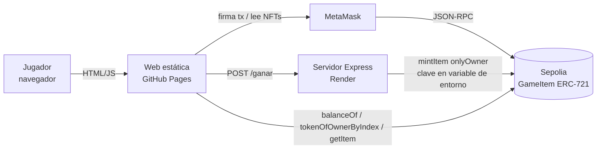
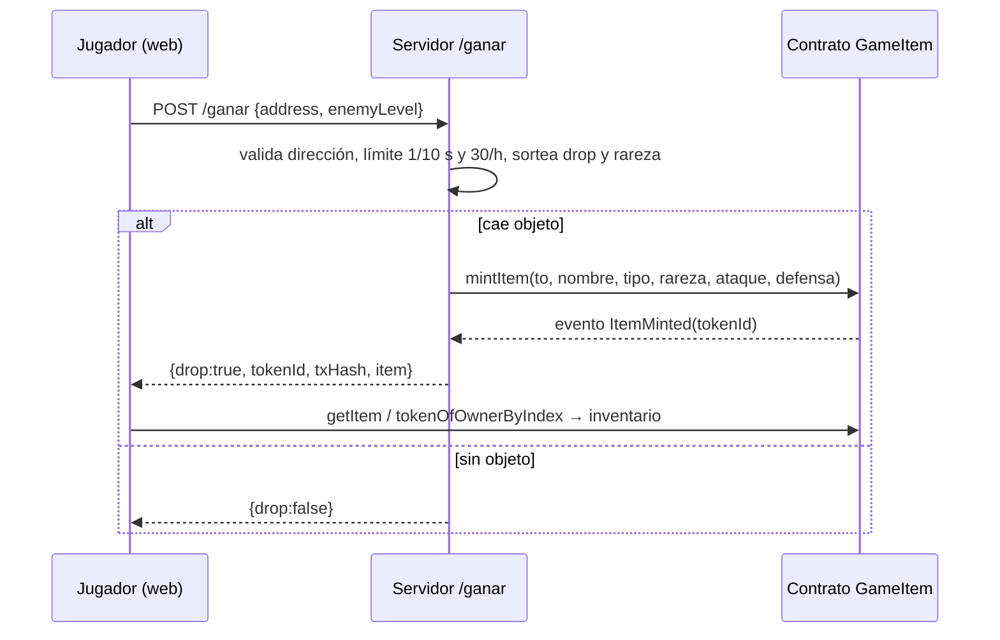

# Memoria — Loot Arena

## 1. Descripción

**Loot Arena** es un mini-RPG de combate por turnos jugable en el navegador. El jugador conecta su wallet de MetaMask (red Sepolia), explora la arena y se enfrenta a enemigos de nivel creciente. Al ganar, el servidor del juego sortea un objeto de equipo; si cae, lo crea como **NFT ERC-721** directamente en la wallet del jugador. Los objetos se pueden **equipar** (suman ataque y defensa) o **transferir** a otra wallet.

### Rarezas

| Rareza | Probabilidad (si hay drop) | Stat principal | Color |
|---|---|---|---|
| Común | 70 % | 1–5 | gris `#9ca3af` |
| Raro | 25 % | 6–12 | azul `#3b82f6` |
| Legendario | 5 % | 13–25 | dorado `#f59e0b` |

La probabilidad de que caiga algún objeto tras una victoria es del 60 %. La stat principal depende del tipo (Espada → ataque; Escudo, Casco, Armadura, Botas → defensa) y la secundaria es ~25 % de la principal.

### Qué aporta la blockchain

- **Propiedad real:** el NFT es de la wallet del jugador; el juego no puede quitárselo.
- **Escasez verificable:** cada objeto, su rareza y sus stats están en el contrato y se consultan públicamente en Etherscan (`getItem`, `totalMinted`, evento `ItemMinted`).
- **Anti-trampas:** `mintItem` es `onlyOwner`; solo la wallet del servidor puede crear objetos.
- **Transferencia libre:** `safeTransferFrom` entre wallets, sin intermediarios.

## 2. Arquitectura

Flujo de una victoria:

### Componentes

| Componente | Tecnología | Detalles |
|---|---|---|
| Contrato | Solidity 0.8.28, OpenZeppelin v5, Hardhat | `ERC721` + `ERC721Enumerable` + `Ownable`; `struct Item {nombre, tipo, rareza, ataque, defensa}`; tokenIds desde 1 |
| Servidor | Node 20, Express, ethers v6 | Validación con `ethers.isAddress`, cola de mints (evita colisiones de nonce), rate limit por dirección e IP, CORS restringido a GitHub Pages |
| Web | HTML + CSS + JS (módulos ES), ethers v6 por CDN | Detección y cambio de red, combate en módulo puro testeado, equipo guardado en `localStorage`, enlaces a Etherscan |
| Hosting | GitHub Pages (Actions), Render (free) | Despliegue automático en cada push a `main` |

## 3. Despliegue

| Elemento | Valor |
|---|---|
| Red | Sepolia (chainId 11155111) |
| Contrato | [`0x32B89E29fACa1b1418B5802b6a2C7de71f3AdA2f`](https://sepolia.etherscan.io/address/0x32B89E29fACa1b1418B5802b6a2C7de71f3AdA2f#code) (código verificado) |
| Tx de despliegue | [`0x31173b14…154a1`](https://sepolia.etherscan.io/tx/0x31173b14842d3508e15c9a093ab3d4d3c345124939fe38584f9356852ba154a1) |
| Owner (servidor) | [`0x903236cfeEf86D2D126CA7D7d3Cb92e9fa114C23`](https://sepolia.etherscan.io/address/0x903236cfeEf86D2D126CA7D7d3Cb92e9fa114C23) |
| Juego | https://cristiangarcia913.github.io/loot-arena/ |
| Servidor | https://loot-arena-cg913.onrender.com |

## 4. Pruebas

**Unitarias:** contrato 12/12 (mint y evento, no-owner no mintea, rareza inválida, stats guardadas, token inexistente, transferencias, enumerable, interfaces), servidor 34/34 (distribución de rarezas en 100 000 tiradas, rangos de stats, validación, 429), web 30/30 (combate).

**Extremo a extremo en Sepolia (5-nov-2026):**

| Prueba | Resultado |
|---|---|
| `GET /health` | `{ok:true, contract:0x32B8…, chainId:11155111}` |
| `POST /ganar` con dirección válida | Mint del token #1 «Escudo Abollado» (Común, 1/3) — [tx](https://sepolia.etherscan.io/tx/0x02b3ad78e379c8c1acb562903f7e01afa8b1a75c3b6e378baed7aac1044a201e) |
| `POST /ganar` con `"hola"` | 400 «Dirección inválida» |
| Dos peticiones simultáneas misma dirección | 200 y 429 |
| Transferencia del #1 a una segunda wallet | `ownerOf`, `balanceOf` y `tokenOfOwnerByIndex` correctos; stats intactas — [tx](https://sepolia.etherscan.io/tx/0x6808a16c4b23bfed3fd28018eba206e3ada8c4ef8791921ab1e0c3d5e9600156) |
| Web: carga, modo demo y combate | Sin errores de consola |

## 5. Capturas

Añadir en `docs/capturas/`: pantalla inicial, combate, botín legendario, inventario con colores, transferencia en MetaMask y contrato en Etherscan.

## 6. Seguridad

- La clave del owner solo existe en `.env` local (ignorado) y en la variable `PRIVATE_KEY` de Render.
- RPC público sin API key (publicnode), así que no hay claves de proveedor.
- Repo protegido por escáner propio de secretos y gitleaks en hooks `pre-commit`/`pre-push` y en CI, más secret scanning y push protection de GitHub.

## 7. Reparto del trabajo

| Persona | Responsabilidad |
|---|---|
| A | Contrato, tests, despliegue y verificación en Sepolia |
| B | Servidor, lógica de drops, límites, despliegue en Render |
| C | Juego web, MetaMask, combate, inventario, transferir, publicación |
| Todos | Pruebas E2E, memoria y demo |

## 8. Limitaciones y mejoras

- El servidor paga el gas de los mints con ETH de prueba: si se agota, hay que recargar del faucet.
- Render free se duerme tras inactividad.
- Mejoras: metadatos `tokenURI` con imagen para verse en marketplaces, mercado entre jugadores, prueba de victoria firmada para que el servidor no confíe solo en el cliente.
